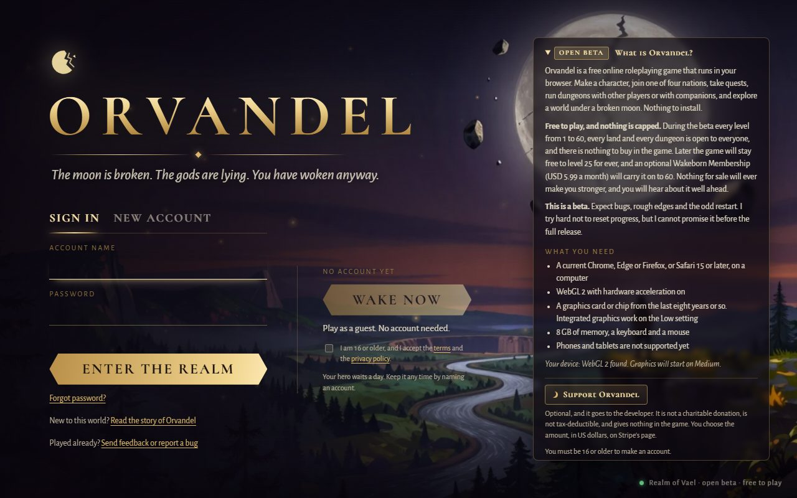
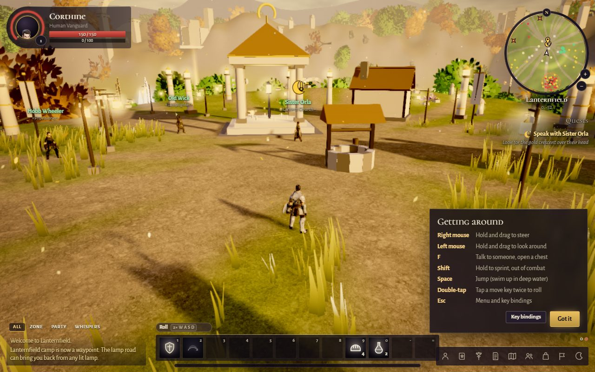
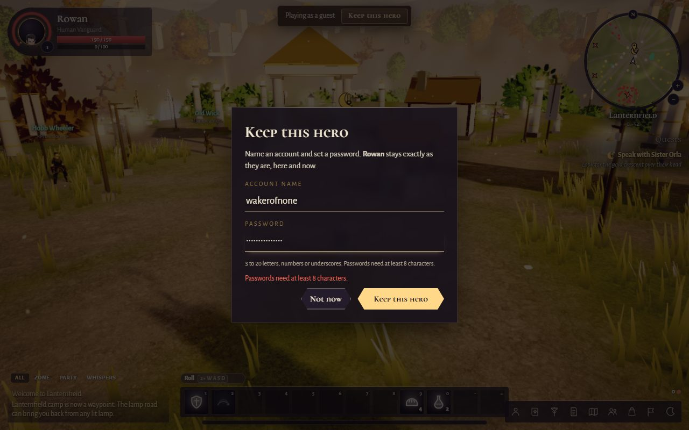

# Orvandel: Wake Now

The planning documents and source code for **Wake Now**, the feature I built with the Devpost Learn Skill Pack for [Build With AI: Basics](https://learn-ai-basics.devpost.com/). It is part of [Orvandel](https://play.jonathansolvesproblems.com), a free browser MMORPG.

Wake Now takes a new player from the title screen into the world in seconds: tick one box, press **Wake now**, and you are standing in a living world as a ready hero, with no account, email or download. If you like your hero, **Keep this hero** turns the guest into a full account with the same character, so nothing is lost.

- Play it: https://play.jonathansolvesproblems.com
- Demo video: https://www.youtube.com/watch?v=Qjugtw2g3Cc
- Devpost entry: https://devpost.com/software/orvandel-a-free-mmorpg-in-your-browser
- Blog post on how it was built: https://jonathanandrei.com/blog/orvandel-browser-mmorpg-wake-now-one-click/

## Why this repository holds part of the game

Orvandel itself is a large game I am continuing to build after the hackathon, so its full source stays private. This repository holds everything that was planned and built with the skill pack: the planning documents, the skill pack itself, the feature's own source files, and the exact code changes the feature made to the game, commit by commit. The game is live, so the feature can be tried end to end at the address above.

## What is here

| Path | What it is |
|---|---|
| [`devpost/scope.md`](devpost/scope.md) | The scope: the smallest version of Wake Now that proves the idea |
| [`devpost/prd.md`](devpost/prd.md) | The product requirements: the player's journey, behaviors, edge cases and acceptance criteria |
| [`devpost/spec.md`](devpost/spec.md) | The technical spec: how guest play fits Orvandel's two backends (a Node server and Cloudflare Workers with Durable Objects and D1) |
| [`devpost/checklist.md`](devpost/checklist.md) | The build checklist: three slices, each verified and committed before the next began |
| [`devpost/app-map.html`](devpost/app-map.html) | The app map from a read-only mapping pass, showing where guest play touches the code |
| [`.agents/skills/`](.agents/skills) | The Devpost Learn Skill Pack as installed (1-start to 6-ship) |
| [`code/`](code) | The files written for the feature: guest rules (`shared/guest.ts`), the Keep this hero ribbon (`client/src/guest-ribbon.ts`), the database migration and the feature's test suite |
| [`patches/`](patches) | The four commits that built Wake Now, as patches: one click into the world, Keep this hero, guest boundaries and cleanup, and the guest rate limit kept in Durable Object storage |
| [`screens/`](screens) | Screenshots taken during the build checks |

## How the feature works

1. **Wake now.** The title screen's 16+ box and Wake now button call one endpoint that creates a guest account and a ready Human Vanguard, signs the browser in, and drops it straight into the world.
2. **Keep this hero.** A ribbon in the world offers to keep the hero. Choosing a name and a password converts the guest into a full account in place, keeping the character, and shows a recovery code once.
3. **Boundaries.** Guests are rate-limited per hour, kept out of dungeons, the raid and the Proving Grounds, warned before logging out (a guest who leaves loses the hero), and cleaned up after 24 idle hours. Every rule behaves the same on both backends, and the tests check both.

Measured during the build: click to controlling the hero in 7.0 to 10.5 seconds, against 12.1 seconds for a normal account's sign-in.

## Screens

| | |
|---|---|
|  |  |
|  |  |

## License

The code in this repository is released under the [GNU Affero General Public License v3.0](LICENSE). The skill pack in `.agents/skills/` is Devpost's, included as installed.
